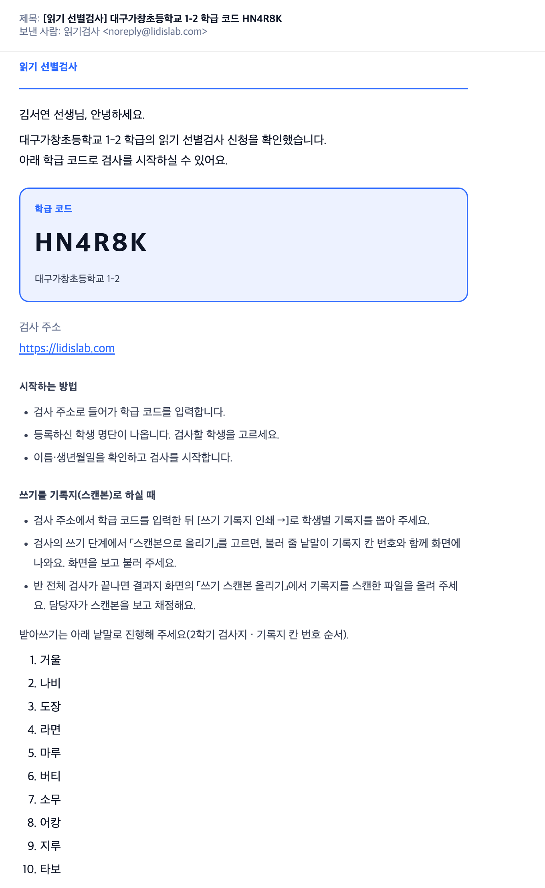
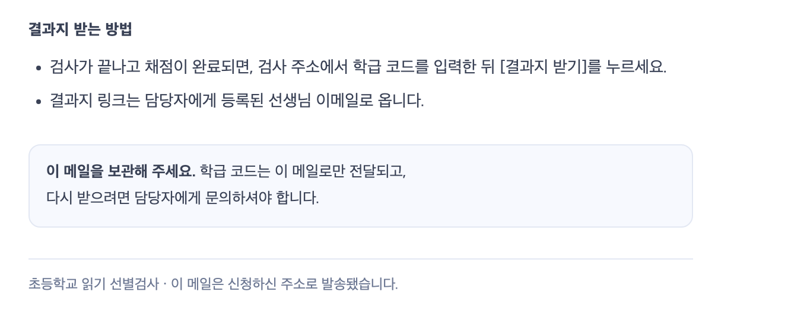

# 읽기 선별검사 — 정해 주시거나 보내 주셔야 할 것

검사 앱(https://lidislab.com)은 지금 바로 쓸 수 있는 상태예요. 다만 아래 항목은 담당자님이 정해 주셔야
앱에 반영할 수 있어요. 항목마다 **지금 앱이 어떻게 되어 있는지**와 **무엇이 필요한지**를 함께 적었어요.

### ☐ 1. 학년·학기별 검사 문항과 판정 기준표 (1~6학년)

- **지금 상태**: 1·2학년 2학기 문항과 기준표는 받아서 반영했어요(양호·주의·위험). 1·2학년 1학기는 예전 문항과
  임시 기준으로 검사해요. 3~6학년은 검사지가 없어서 같은 학기의 1학년 검사지로 검사해요.

- **필요한 것**:
  - 1·2학년 1학기 새 문항과 기준표(내년 3월 검사 전까지)
  - 3~6학년 각 학년의 1학기·2학기 문항과 기준표

### ☐ 2. 안내·동의 문구 확인

- **필요한 것**: 아래 문구를 그대로 써도 되는지 확인해 주세요. 고칠 곳이 있으면 표시해 주세요.
  - 그림 1: 노란색으로 칠한 부분만
  - 그림 2·3·4: 전체

  그림 1에서 칠하지 않은 문구는 이미 확인해 주신 거라 보지 않으셔도 돼요.

**그림 1. 선생님 신청 화면: 검사 안내와 동의 체크** (lidislab.com/apply 아래쪽)

**그림 2. 승인 메일** (신청을 승인하면 선생님께 자동으로 가는 메일. 학교·이름·코드·받아쓰기 낱말은 예시)

**그림 2. 승인 메일 (이어서)** (받아쓰기 낱말 아래 끝부분)

**그림 3. 시작 화면 개인정보 안내** (선생님이 학급 코드를 넣으면 나오는 안내와 확인 체크)

**그림 4. 아이용 녹음 안내** (마이크 확인 화면 아래쪽 두 줄)

아래쪽 두 줄 확대

### ☐ 3. 결과보고서의 「지역 / 학교」 표기

- **필요한 것**: 지역 / 학교 표기 방식이 맞는지 확인해 주세요. (학기 구분 3~8월 1학기 · 9~2월 2학기는 확인해 주셨어요.)

**지역 / 학교**: 예시로 주신 「춘천 교동초등학교」와 같은 모양으로 맞췄어요.

| 경우 | 표기 | 예 |
|---|---|---|
| 도 지역 학교 | 시·군 이름(「시」「군」 없이) + 학교명 | 춘천 교동초등학교 |
| 특별시·광역시·세종 학교 | 도시 이름 + 학교명 | 부산 운산초등학교 |
| 학교 이름이 지역 이름으로 시작 | 지역을 겹쳐 쓰지 않음 | 대구성지초등학교 |
| 도의 시 이름이 광역시 이름과 같음 | 도 이름을 앞에 붙임 | 경기 광주 ○○초등학교 |
| 위 규칙으로도 다른 학교와 표기가 같아짐 (전국 3쌍) | 도는 도 이름, 광역시는 구 이름을 더 붙임 | 강원 고성 동광초등학교 · 부산 해운대구 송정초등학교 |

