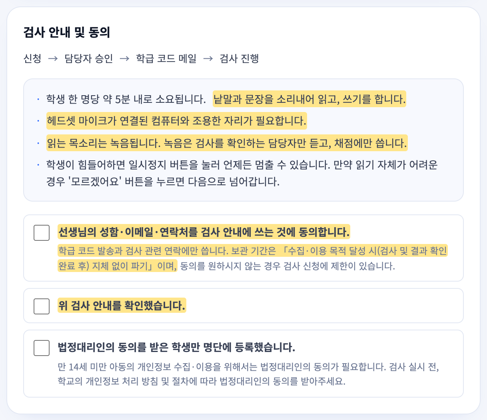
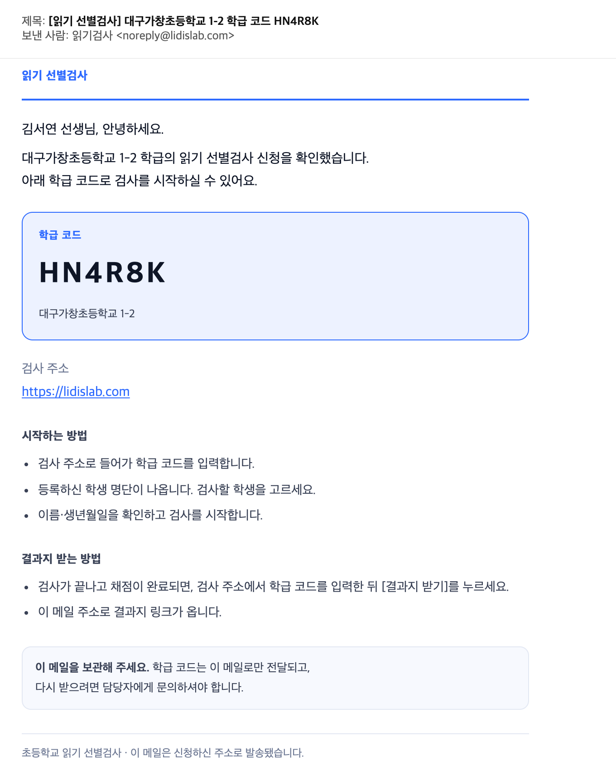
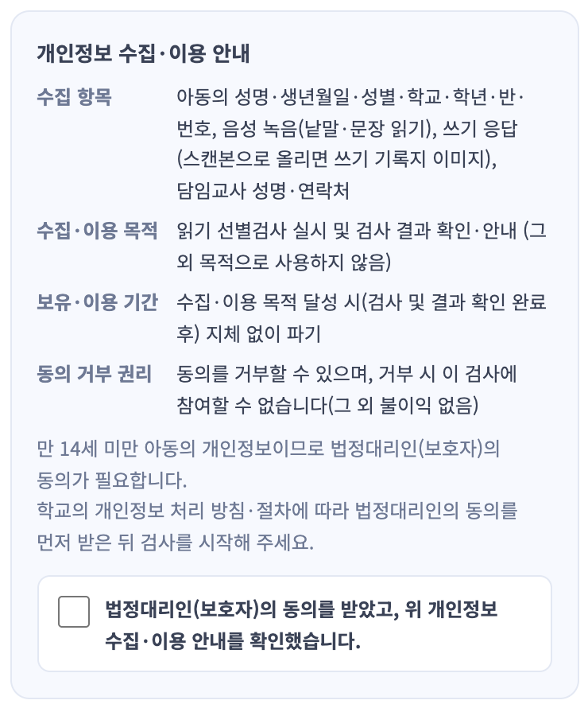
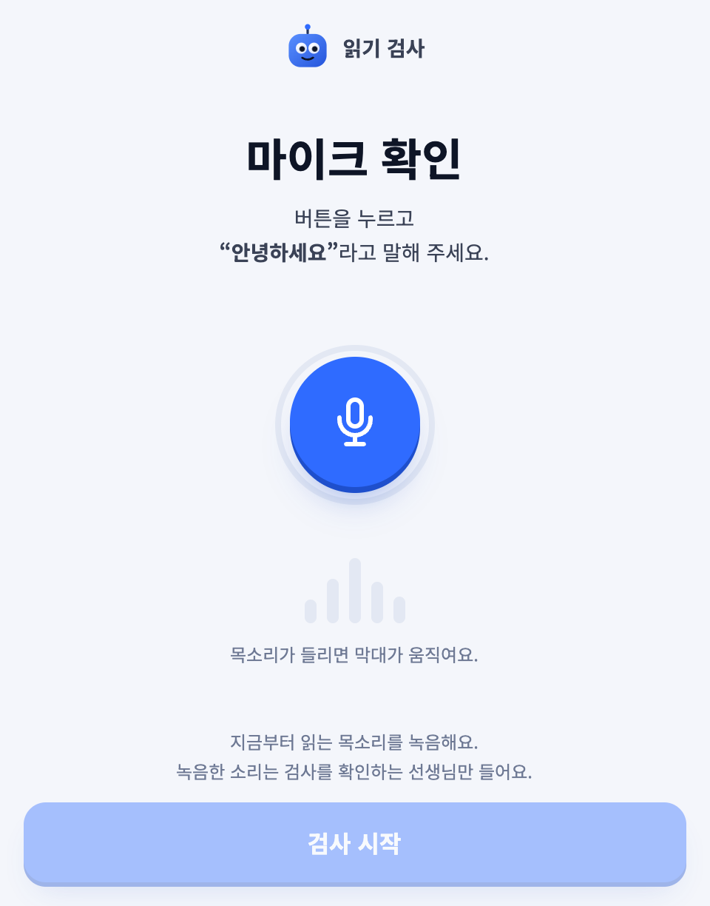
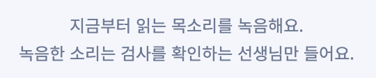

# 읽기 선별검사 — 정해 주시거나 보내 주셔야 할 것

검사 앱(https://lidislab.com)은 지금 바로 쓸 수 있는 상태예요. 다만 아래 항목은 담당자님이 정해 주셔야
앱에 반영할 수 있어요. 항목마다 **지금 앱이 어떻게 되어 있는지**와 **무엇이 필요한지**를 함께 적었어요.

### ☐ 1. 학년·학기별 검사 문항과 Pass 기준표 (1~6학년)

- **지금 상태**: 1·2학년만 검사지가 있고, 학기 구분 없이 학년마다 하나씩이에요. Pass 기준은 임시값이에요.

  | 과제 | 1학년 | 2학년 | 지금 Pass 기준(임시) |
  |---|---|---|---|
  | 낱말 읽기 | 의미 7개 + 무의미 7개 (14점) | 의미 7개 + 무의미 7개 (14점) | 9점 이상 |
  | 문장 읽기유창성 | 문장 4개 | 문장 4개 | 1.0 어절/초 이상 |
  | 쓰기 | 낱말 10개 (10점) | 문장 5개 (10점) | 6점 이상 |

  3~6학년은 검사지가 없어서 지금은 1학년 검사지로 검사해요.

- **필요한 것**: 1~6학년 각 학년의 1학기·2학기마다 아래 두 가지를 보내 주세요.
  - 낱말 읽기·문장 읽기·쓰기 문항 목록
  - 위 세 과제의 Pass 기준 (문장 읽기유창성은 "어절/초" 단위)

### ☐ 2. 쓰기 기록지 양식 파일

- **필요한 것**: 오프라인으로 쓰기 검사를 할 때 쓰는 기록지 양식 파일을 보내 주세요.

### ☐ 3. 안내·동의 문구 확인

- **필요한 것**: 아래 문구를 그대로 써도 되는지 확인해 주세요. 고칠 곳이 있으면 표시해 주세요.
  - 그림 1: 노란색으로 칠한 부분만
  - 그림 2·3·4: 전체

  그림 1에서 칠하지 않은 문구는 이미 확인해 주신 거라 보지 않으셔도 돼요.

**그림 1. 선생님 신청 화면: 검사 안내와 동의 체크** (lidislab.com/apply 아래쪽)

**그림 2. 승인 메일** (신청을 승인하면 선생님께 자동으로 가는 메일. 학교·이름·코드는 예시)

**그림 3. 시작 화면 개인정보 안내** (선생님이 학급 코드를 넣으면 나오는 안내와 확인 체크)

**그림 4. 아이용 녹음 안내** (마이크 확인 화면 아래쪽 두 줄)

아래쪽 두 줄 확대

### ☐ 4. 연습 문항 종류

- **지금 상태**: 본 검사 전에 연습할 때 **쉬운 실제 낱말**을 보여 주고 있어요.
- **필요한 것**: 연습 문항이 "쉬운 실제 낱말"이 맞는지, 아니면 "무의미 낱말(아로·부림 같은)"이어야
  하는지 확인해 주세요. 무의미 낱말이라면 연습에서 미리 경험하는 것이 본 검사에 영향을 줄 수 있어서
  문항을 어떻게 고를지도 함께 알려 주세요.

### ☐ 5. 결과보고서의 「지역 / 학교」·「학년 / 학기」 표기

- **필요한 것**: 지금 표기 방식이 맞는지 확인해 주세요.

**지역 / 학교**: 예시로 주신 「춘천 교동초등학교」와 같은 모양으로 맞췄어요.

| 경우 | 표기 | 예 |
|---|---|---|
| 도 지역 학교 | 시·군 이름(「시」「군」 없이) + 학교명 | 춘천 교동초등학교 |
| 특별시·광역시·세종 학교 | 도시 이름 + 학교명 | 부산 운산초등학교 |
| 학교 이름이 지역 이름으로 시작 | 지역을 겹쳐 쓰지 않음 | 대구성지초등학교 |
| 도의 시 이름이 광역시 이름과 같음 | 도 이름을 앞에 붙임 | 경기 광주 ○○초등학교 |
| 위 규칙으로도 다른 학교와 표기가 같아짐 (전국 3쌍) | 도는 도 이름, 광역시는 구 이름을 더 붙임 | 강원 고성 동광초등학교 · 부산 해운대구 송정초등학교 |

**학년 / 학기**: 검사한 달로 정해요. 3~8월이면 1학기, 9~2월이면 2학기예요.
1번의 학기별 검사지를 받으면 검사지 기준으로 바꿀게요.
